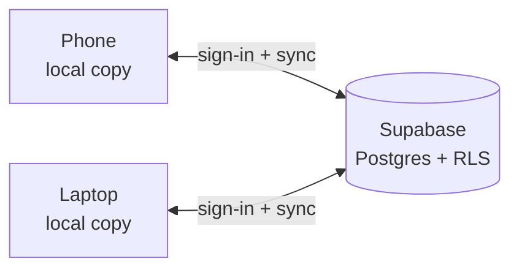

# 🚘 Garage Manager

**An offline-first, installable web app for managing multiple cars, mileage claims, repairs and reminders, with secure sign-in and automatic sync between phone and computer.**

[

**Live demo:** `https://sk-garage.netlify.app/?demo` &nbsp;·&nbsp; **Try it:** create a free account (10 seconds), then *Settings → 🧪 Load sample data*.

<p align="center">
  
</p>
<p align="center">
  
  &nbsp;&nbsp;
  
</p>

> The screenshots use fictional demo data.

## Why I built it
I needed one place to track the mileage I could claim back, repair costs and service reminders for more than one car, and I needed it on my phone in the garage, where signal is unreliable. Spreadsheets didn't work on a phone, and most apps wanted a subscription. So I built the app, then grew it from a single-device tool into a synced, multi-device product.

## Features
- **Multiple cars**, each with its own photo, owner details, trips, repairs (with images), fuel log, maintenance and reminders
- **Mileage tracker** with reimbursement calculation and road-distance lookup on a map (OpenStreetMap + OSRM)
- **Reports and exports** (CSV, full JSON backup and restore)
- **Email + password accounts** with password reset, auto-lock on inactivity and optional password-on-open
- **Automatic sync** across devices, with a live status indicator (✅ Synced · 🔄 Syncing · 📴 Offline)
- **Works offline.** Edits are saved on the device and uploaded when the connection returns
- **Installable** on Android and iOS (PWA), packaged as an APK through PWABuilder
- Light and dark mode, responsive layout

## Tech stack
| Area | Choice |
|---|---|
| Front end | Vanilla JavaScript, HTML, CSS (a single-file app, no build step) |
| Backend | [Supabase](https://supabase.com): Auth + Postgres + Row Level Security |
| Offline / install | Service Worker, Web App Manifest (maskable icons) |
| Sync engine | `cloud.js`: custom, about 350 lines, talks to Supabase over REST (no SDK) |
| Tests | Node, with an in-memory mock of Supabase Auth and PostgREST |
| Hosting | Any static host (Netlify, GitHub Pages, Cloudflare Pages) |

## How sync works


The app always works against the local copy, so it is fast and usable offline. A background sync loop reconciles with the cloud:

- **One row per car.** Only cars that changed are uploaded.
- **Photos are stored once.** Images are extracted, hashed (SHA-256) and stored in a separate table, so adding a trip uploads a few KB instead of megabytes of photos.
- **Change detection** uses a canonical (key-sorted) content hash per car, so a car only counts as changed when its content really changed.
- **Optimistic concurrency.** Updates are conditional on the version the device last saw (`PATCH … WHERE ts = <known>`), so one device can't silently overwrite another's newer edit.
- **Nothing is silently lost.** If two devices edit the *same car* while apart, the cloud version is kept and the device's version is saved as a "conflict copy".
- **Deletions propagate** through tombstones, so a deleted car disappears everywhere.
- **Polling plus triggers.** The app syncs every 30 seconds, on focus, when it comes back online and shortly after each save. Incoming changes wait while you are typing in a form.
- **Security.** Row Level Security policies mean a signed-in user can only ever read or write their own rows. The public `anon` key in `config.js` is safe to publish for that reason. Sign-out wipes the local copy from the device, and tokens refresh silently.

## Run it yourself
1. Create a free Supabase project and run [`supabase-setup.sql`](supabase-setup.sql) in the SQL editor.
2. Put your project URL and anon key in [`config.js`](config.js).
3. Serve the folder with any static host (or `npx serve .` locally).

Full step-by-step guide: [`docs/SETUP.md`](docs/SETUP.md). Leave `config.js` empty and the app runs in local-only mode (no sign-in or sync).

## Tests
```bash
npm test
```
Runs 11 scenarios against a mock Supabase: first upload, a fresh second device, two-way edits, same-car conflicts, deletes, backup restore, offline then online, deferral while editing, token refresh, per-account isolation and flush-before-sign-out.

## Design decisions and trade-offs
- **No framework or SDK.** The app is small, and avoiding a build step keeps it easy to host and to install as a PWA. I wrote a thin Supabase REST client instead of loading the SDK, which keeps the service worker simple and offline use reliable.
- **Per-car, last-writer-aware sync, not field-level merge.** Records inside a car have no IDs, so a safe automatic merge isn't possible. I chose "keep both versions" over "pick a winner".
- **Local-first.** The app doesn't wait for the network, so that's the right call for a tool used in garages and car parks.

## Known limitations / roadmap
- Each account has its own garage. Sharing one garage between several people isn't built yet.
- Conflicts are resolved at car level, so the user compares the two versions by hand.
- Passwords are handled entirely by Supabase Auth. There is no social login or 2FA yet.
- The browser keeps a local copy, so use a device lock on shared devices.

## License
MIT, see [LICENSE](Sunday).
